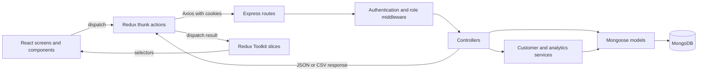
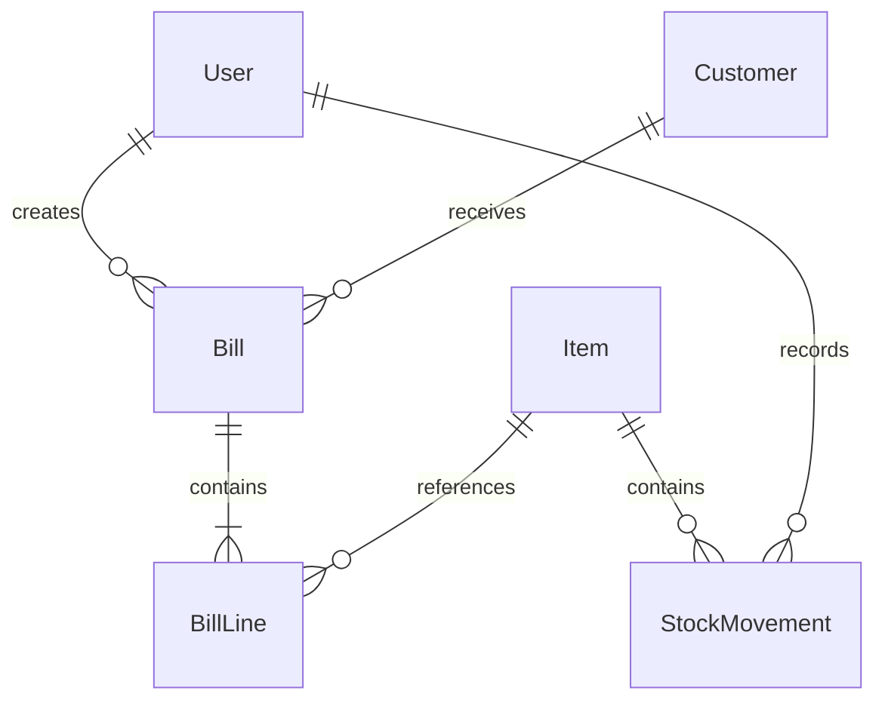

# Inventory & Sales Management

A MERN application for managing inventory, restocks, customers, sales bills, user accounts, and sales reports. The Express API lives at the repository root; the React application lives in `client/`.

## Features

- Inventory creation, stock additions, archiving, and restoration.
- Opening-stock and restock records with quantities, dates, and the user who recorded them.
- Customer profiles, purchase history, and linked bills.
- Billing with server-side prices, quantity validation, stock deductions, and a 5% addition to line totals.
- Sales summary, previous-period comparisons, daily/monthly trends, product performance, and CSV export.
- Cookie-based authentication, profile photos, and password changes requiring the current password.
- Admin-only user management: edit name/email, assign roles, and disable/reactivate accounts.
- Responsive pages styled with Tailwind CSS, Headless UI, and Heroicons.

## Architecture



### Frontend

`client/src/index.js` provides the Redux store and configures Axios to send cookies and request tracing headers. `App.js` checks the current session on startup and defines public and protected routes.

- **Screens/components** render data, dispatch actions, and retain local UI state such as form drafts and search inputs.
- **Action files** contain API requests and dispatch request/success/failure actions.
- **Slices** own shared data and request state.
- **ProtectedWrapper** waits for the initial session check and redirects unauthenticated visitors to login, preserving their destination.
- **Layout** loads inventory and bills and renders the shared sidebar.
- **SideMenu** shows admin navigation only when the authenticated user has `role: "admin"`.

The store is configured in [`client/src/store/store.js`](client/src/store/store.js):

| Store key | Responsibility |
| --- | --- |
| `user` | Session, authenticated user, profile photo state |
| `register` | Registration request state |
| `inventory` | Inventory records and loading state |
| `sales` | Bill composition and selected sale items |
| `bills` | Saved bills and sales history |
| `customers` | Customer records and request state |
| `admin` | User management data and save/load feedback |
| `analytics` | Reports, request IDs, and CSV export state |

Admin and analytics data are cleared on logout or loss of authentication. Analytics request IDs prevent an older response from replacing results for newer filters.

### Backend

- **`app.js`** creates Express with parsers, cookies, CORS, tracing, routes, and error handling. Importing it does not connect to MongoDB or open a port.
- **`server.js`** loads environment configuration, connects to MongoDB before listening, and reports startup/connection errors.
- **`routes/`** maps HTTP endpoints to middleware and controllers.
- **`middleware/`** verifies authentication and admin roles, parses photo uploads, attaches request context, and handles errors.
- **`controllers/`** validates requests, coordinates persistence, and returns responses.
- **`services/`** resolves customer identities and builds aggregated analytics reports.
- **`modals/`** contains Mongoose models. The existing directory spelling is retained.
- **`utils/logger.js`** configures structured Pino logging.

## Repository layout

```text
inventory-sales-management/
├── compose.yaml
├── Dockerfile
├── .dockerignore
├── app.js
├── server.js
├── package.json
├── .env.sample
├── .env.docker.sample
├── controllers/
│   ├── userController.js
│   ├── adminController.js
│   ├── healthController.js
│   ├── inventryController.js
│   ├── customerController.js
│   ├── billController.js
│   └── analyticsController.js
├── middleware/
│   ├── authMiddleware.js
│   ├── profilePhotoUpload.js
│   ├── requestContext.js
│   └── errorMiddleware.js
├── modals/
│   ├── userModal.js
│   ├── itemModal.js
│   ├── CustomerModal.js
│   └── BillingModal.js
├── routes/
├── services/
│   ├── customerService.js
│   └── analyticsService.js
├── utils/logger.js
├── tests/
│   ├── helpers.js
│   ├── *.api.test.js
│   └── *.test.js
├── scripts/
│   ├── ADMIN_SETUP.md
│   ├── ANALYTICS.md
│   └── DOCKER.md
└── client/
    ├── Dockerfile
    ├── .dockerignore
    ├── nginx/default.conf.template
    ├── package.json
    ├── tailwind.config.js
    ├── public/
    └── src/
        ├── App.js
        ├── index.js
        ├── ProtectedWrapper.js
        ├── components/
        ├── screens/
        └── store/
```

## Data model and attribution



`BillLine` and `StockMovement` are embedded documents, not separate collections.

| Model | Stored data |
| --- | --- |
| User | Name, email, hashed password, role, active status, profile photo, timestamps |
| Item | Name/manufacturer, normalized identity, current quantity, unit selling price (`ppp`), attribution, stock movements |
| Customer | Name, normalized name, company, optional email/phone, active status, attribution |
| Bill | Customer reference, creator, embedded item references/quantities/unit prices/line amounts, final total (`subTotal`), timestamps |

Attribution uses existing fields: `createdBy`, `updatedBy`, `archivedBy`, `archivedAt`, `restoredBy`, `restoredAt`, and Mongoose timestamps. Each stock movement has `performedBy` and `createdAt`. There is no separate `auditHistory` collection or array.

Actors are assigned from the authenticated user rather than trusted from request bodies. Latest-update and archive/restore fields describe the latest recorded action; they do not preserve every historical edit.

Items are archived rather than deleted. Customers referenced by bills are archived when removed; customers without linked bills can be deleted. Admin user management disables accounts rather than deleting them, preserving existing references.

## Authentication and authorization

The API signs a JWT containing the user ID and stores it in an HTTP-only `jwt` cookie. The token and cookie lifetime are 30 days. On protected requests, `protect` verifies the token and reloads the user from MongoDB, rejecting missing users and disabled accounts.

`requireAdmin` runs after `protect` on admin endpoints and checks the database-derived role. Hiding sidebar links is only a UI convenience; backend middleware enforces access.

- Public registration always creates a `user`, even if a request supplies another role.
- Existing accounts without a role are treated as ordinary users.
- Admins cannot demote or disable their own accounts through the panel.
- Inventory, customers, bills, and analytics are shared workspace resources available to authenticated users; these routes are not restricted to admins.
- Password changes verify the current password and confirmation, enforce the existing 6–23 character policy, and use the model save hook to hash the new password. Existing JWT sessions are not revoked by a password change.
- Profile photos accept JPEG, PNG, or WebP up to 2 MB and are stored in MongoDB. Uploads use multipart field `photo`.

To enable the first admin, set a trusted user's database document to `role: "admin"`, then refresh the app or sign in again. See [`scripts/ADMIN_SETUP.md`](scripts/ADMIN_SETUP.md).

## API routes

All paths below are relative to the API server. Authentication is required unless marked public.

| Method | Path | Purpose |
| --- | --- | --- |
| GET | `/api/health` | Readiness and MongoDB ping; public; 200 when ready, otherwise 503 |
| GET | `/api/health/live` | HTTP process liveness; public; 200 independently of MongoDB |
| POST | `/api/user/register` | Register an ordinary user; public |
| POST | `/api/user/login` | Sign in; public |
| POST | `/api/user/logout` | Clear the session cookie |
| GET | `/api/user/getuser` | Read the authenticated profile and role |
| PATCH | `/api/user/password` | Change password |
| GET / POST / DELETE | `/api/user/profile-photo` | Read, upload, or remove a profile photo |
| GET | `/api/user/admin/users` | List users; admin only |
| GET | `/api/user/admin/users/:id/profile-photo` | Read a user's profile photo; admin only |
| PATCH | `/api/user/admin/users/:id` | Update name/email/role/status; admin only |
| GET | `/api/inventory/getitems` | List inventory; optional `includeArchived=true` |
| POST | `/api/inventory/addtoinventory` | Create an item with opening stock |
| POST | `/api/inventory/addstock/:id` | Add stock and record the actor |
| PATCH | `/api/inventory/archive/:id` | Archive an item |
| PATCH | `/api/inventory/restore/:id` | Restore an item |
| GET / POST | `/api/customer` | List or create customers |
| PUT | `/api/customer/:id` | Update customer details |
| DELETE | `/api/customer/:id` | Archive a referenced customer or delete an unreferenced one |
| POST | `/api/customer/:id/restore` | Restore a customer |
| POST | `/api/bill/newbill` | Validate stock and create a bill |
| GET | `/api/bill/allbills` | Read bill history with related records |
| GET | `/api/analytics/sales` | Read sales summary, trend, and product report |
| GET | `/api/analytics/sales/export` | Download a CSV report |

## Reporting

Analytics are calculated on the backend from stored bills. The frontend does not calculate the report from the entire bill list.

- Custom date ranges and today, 7-day, 30-day, monthly, and all-time presets.
- Asia/Kolkata date boundaries and zero-sales trend buckets.
- Daily buckets for ranges up to 90 days; monthly buckets for longer ranges.
- Previous equal-length period comparisons, using the same elapsed time when today is included. All-time reports have no previous-period comparison.
- Sales before additions, billed total, additions, bill count, units sold, and average bill.
- Product search, ranking, 20-row pagination, sales share, distinct bill count, last sale in the selected period, and current stock.
- CSV with summary, trend, and all matching products across every page.

Report query parameters:

```text
from=YYYY-MM-DD&to=YYYY-MM-DD
or: allTime=true

Optional:
search=<product or manufacturer>
sort=sales|quantity|name|lastSale|stock
page=<positive integer>
```

Product search and sorting affect product rows, not the overall summary or trend. Sales share is calculated against all product sales in the period.

Sales before additions sum stored line amounts; billed totals sum `subTotal`. Additions are the difference, not a reconstructed tax calculation. Current billing applies a 5% addition. These reports do not calculate profit, money collected, outstanding payments, or returns, because the required data is not yet modeled.

Product names/manufacturers reflect current inventory records. Stock reflects the current balance, not a historical balance. Bills without a recorded creation date are excluded from dated reports. Exports query fresh data and can reflect changes since the on-screen report was generated.

See [`scripts/ANALYTICS.md`](scripts/ANALYTICS.md) for calculation details and manual verification scenarios.

## Local setup

Prerequisites: Node.js, npm, and an accessible MongoDB database. Install server and client dependencies separately.

From the repository root:

```sh
npm install
cp .env.sample .env
```

Edit the root `.env` with your own connection string and signing secret:

```dotenv
nodeEnv=development
port=5000
clientOrigin=http://localhost:3000
cookieSameSite=lax
LOG_LEVEL=debug
SERVICE_NAME=inventory-sales-management-api
mongoUrl=mongodb://127.0.0.1:27017/inventory_sales
jwtSecret=replace-with-a-long-random-secret
```

Use a full MongoDB connection URI; the sample file's `mongoUrl=todolistDB` is a placeholder. Do not commit `.env` or real credentials.

Start the API in one terminal:

```sh
npm start
```

Start the frontend in another terminal:

```sh
cd client
npm install
npm start
```

The frontend runs at `http://localhost:3000`. Its development proxy targets `http://localhost:5000`, so keep the API's `port` aligned or update `client/package.json`. Without a configured port, the API defaults to 8000.

The root `npm run server` script uses `nodemon`, which is not declared as a project dependency; use `npm start` unless nodemon is separately available.

### Configuration

| Variable | Purpose |
| --- | --- |
| `mongoUrl` | MongoDB connection URI |
| `jwtSecret` | JWT signing secret |
| `port` | API listening port |
| `nodeEnv` / `NODE_ENV` | Production/development behavior |
| `clientOrigin` | Comma-separated allowed frontend origins |
| `cookieSameSite` | Cookie SameSite policy; defaults to `lax` |
| `LOG_LEVEL` | Pino log level |
| `SERVICE_NAME` | Service identifier in logs |

Production mode uses secure cookies. `cookieSameSite=none` also enables secure cookies. Configure HTTPS and allowed origins accordingly. The Express server currently serves the API; it does not serve the React build. Production frontend hosting must route browser paths back to its `index.html` and route `/api` requests to the backend, or provide an equivalent API URL configuration.

## Docker

The root `compose.yaml` builds and starts both applications on a shared network. It uses your existing MongoDB database and reads backend runtime configuration from the root `.env`. If you do not already have `.env`, create it from the Docker example:

```sh
cp .env.docker.sample .env
```

Set `mongoUrl` and `jwtSecret` in `.env`, then start the application:

```sh
docker compose up --build -d
```

Open `http://localhost:8080`. The frontend waits for the backend health check before starting, and only the frontend port is published. Use `docker compose logs -f` for logs and `docker compose down` to stop the applications.

For another device on the same network, open `http://<server-LAN-IP>:8080` and include that exact origin in `.env`'s comma-separated `clientOrigin` value. Local HTTP uses development mode and `cookieSameSite=lax`; production mode requires HTTPS for session cookies. Frontend tracing supports HTTP LAN origins and does not prevent requests if browser crypto or session storage is unavailable. After changing frontend source, rebuild its image with `docker compose up -d --build frontend` and reload the browser.

To build the images individually:

```sh
docker build -t stockroom-backend .
docker build -t stockroom-frontend ./client
```

The backend image runs Node.js on port 5000. The frontend image serves the React build through Nginx on port 8080, supports React Router refreshes, and proxies `/api/` to `BACKEND_URL` (default `http://backend:5000`). Both runtime containers run as non-root users, and environment files are excluded from their images.

See [`scripts/DOCKER.md`](scripts/DOCKER.md) for network setup, runtime environment variables, existing MongoDB connectivity, and HTTPS cookie configuration. Docker builds and container startup have not been verified in this session.

## Health checks

`GET /api/health` checks the existing MongoDB connection and issues a lightweight `ping`. It returns HTTP 200 when connected and responsive, or HTTP 503 when disconnected, connecting, disconnecting, failing, or exceeding the one-second probe timeout. It does not create a new database connection. Docker's backend health check uses this endpoint.

`GET /api/health/live` returns HTTP 200 when the HTTP process responds, independently of database availability. Both endpoints are public, return JSON with `status`, `service`, an ISO timestamp, and `uptimeSeconds`, and set `Cache-Control: no-store`. Readiness additionally returns `checks.mongodb.status` as `up` or `down`, without exposing database configuration or error details.

Through Docker Compose, open `http://localhost:8080/api/health` or use your server's LAN address. `/healthz` on the frontend only checks Nginx. The backend begins listening after its initial MongoDB connection succeeds, so probes cannot reach it during that initial connection attempt.

## Logging and errors

The client sends `traceparent`, `X-Trace-Id`, `X-Span-Id`, and `X-Client-Id` headers. Request middleware attaches context to a child Pino logger and returns tracing headers for correlation. Request completion logs include method, path, status, duration, and the authenticated user ID when available.

Controllers emit events for operations such as billing, restocks, and admin updates. The shared error handler returns a message and trace ID, with stack traces included in development mode.

## Checks and current limitations

Backend tests use Node's built-in test runner. Use Node.js 22.8 or newer; no additional test dependencies are required.

From the repository root:

```sh
npm test
npm run test:coverage
```

The coverage command enforces 100% lines, branches, and functions across the backend application, startup, routes, controllers, middleware, services, models, and logger. It exits unsuccessfully if a threshold is missed. A configured threshold is not a measured coverage result: these tests have been source-reviewed but have not been executed in this session under the read/write-only restriction.

API tests send HTTP requests through real Express routes and middleware on temporary loopback ports. Database calls use isolated mocks; schema tests exercise real Mongoose validation and password hooks with driver writes stubbed. Tests do not load `.env` or connect to the application database. MongoDB aggregation execution, index enforcement, and concurrent writes still need separate database integration tests. See [`tests/README.md`](tests/README.md) for the API test map and scope.

The client exposes the standard React Scripts commands:

```sh
cd client
npm run build
npm test
```

Billing currently compensates failed operations by restoring deducted stock rather than using a multi-document transaction. Product analytics aggregates sales in MongoDB, then merges catalog metadata, sorts, and paginates in server memory. Larger deployments may need transaction-backed billing and database-side product pagination.

Customer analytics, inventory-planning reports, purchase-cost tracking, payments, and returns are future extensions rather than implemented reports.
